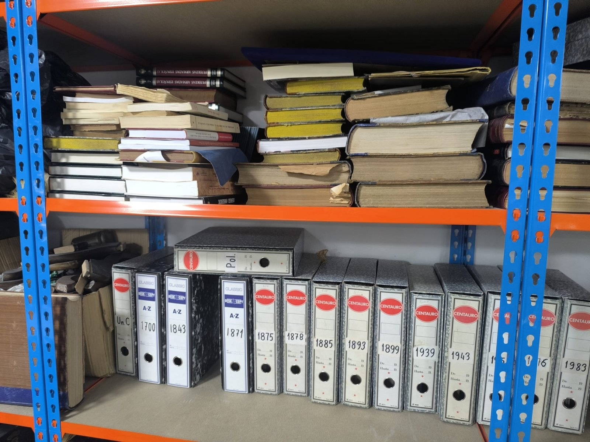
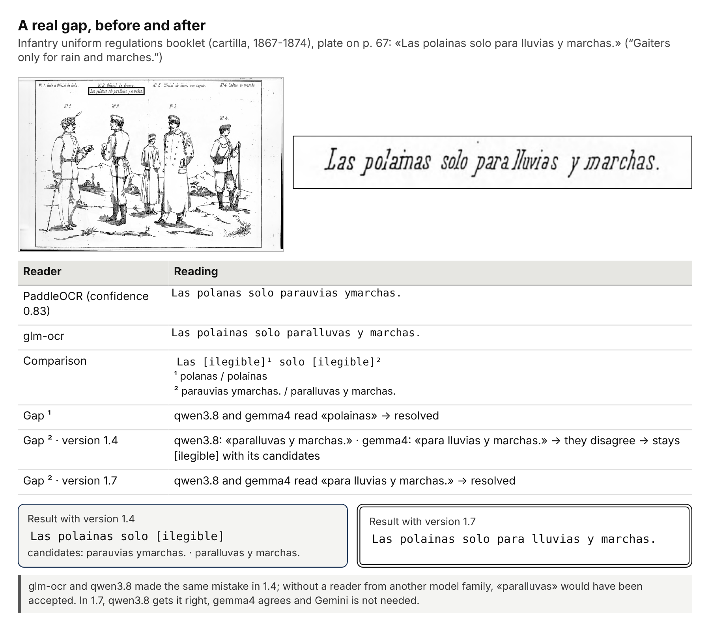
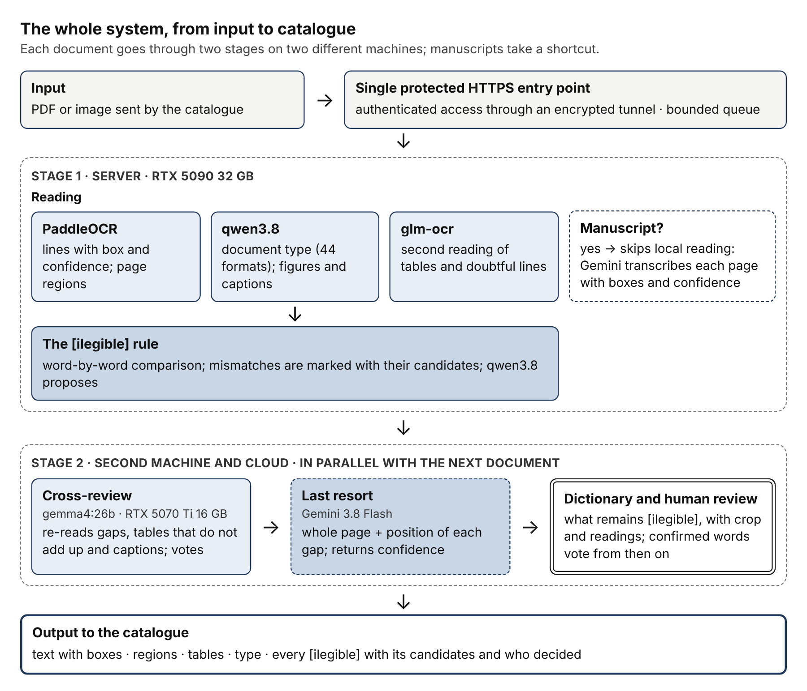
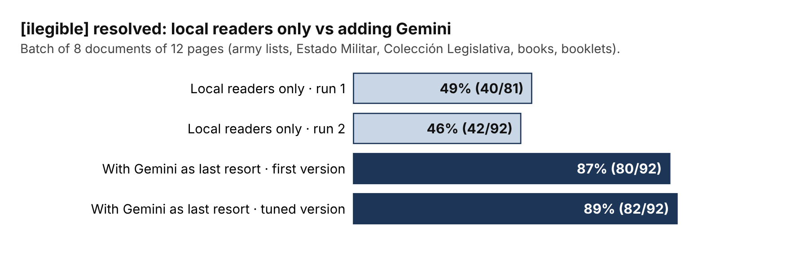
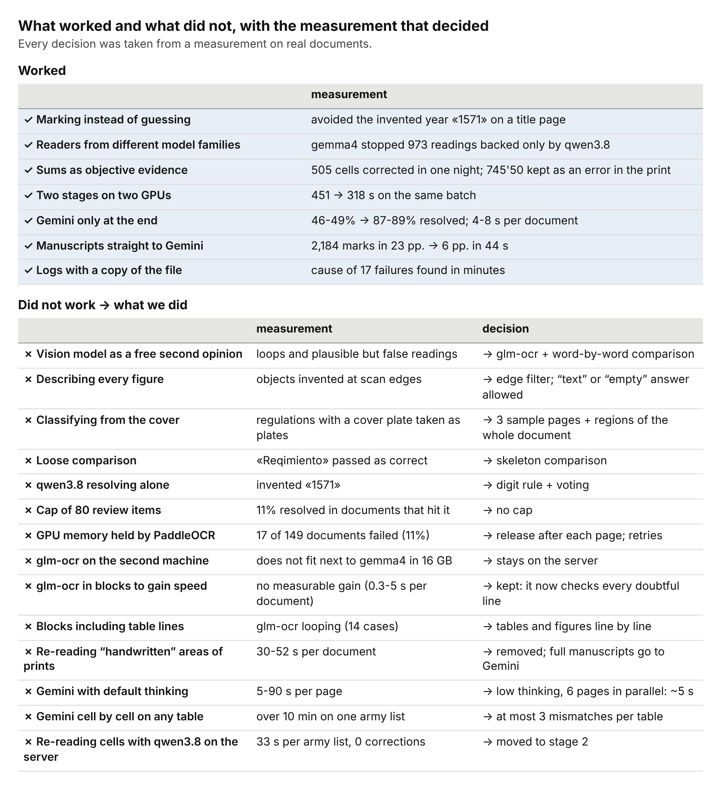
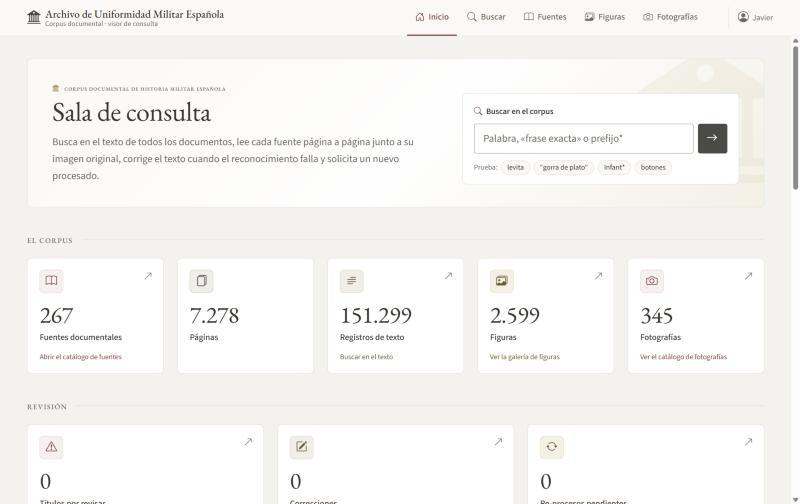
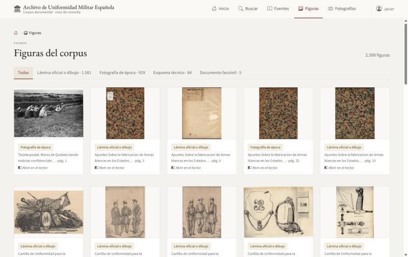

# An OCR engine for a historical military archive

**Two GPUs, five readers and not a single invented word.**
Preliminary technical report (18 pages, English and Spanish). Work in progress.

> Status: the engine is built and has been tested on about 4,000 real pages, and a viewer to read and correct its output is in use. The main work is still ahead: the archive's 300,000+ pages. Code and scans are not released.

## The problem

The job is to digitise an archive of Spanish military uniform documentation: more than 300,000 pages of regulations, booklets, official gazettes, army lists, plates and handwritten documents from the 18th to the 20th century.

One requirement drives the whole design: **the system must not invent anything.** Plausible but false text is worse than a gap, because it enters the catalogue and nobody looks at it again. Whatever is not read with certainty is returned as `[ilegible]` together with the candidate readings, and it stays that way until two independent readers agree.

## How it works

Everything runs on my own hardware, with a cloud model only as a last resort.

- **Stage 1, server with an RTX 5090 (32 GB):** PaddleOCR reads lines with boxes and confidence; glm-ocr gives a second reading of tables and doubtful lines; qwen3.8 classifies the document and reads figures and captions. A word-by-word comparison marks every mismatch as `[ilegible]` with its candidates.
- **Stage 2, second machine with an RTX 5070 Ti (16 GB):** gemma4, a model from a different family, re-reads the gaps and votes. It runs in parallel with the next document.
- **Last resort:** Gemini 3.8 Flash sees the whole page and the position of each remaining gap. It also transcribes handwritten documents directly.
- **Tables:** two readings plus arithmetic. Row and column sums are the only evidence that does not depend on any model.
- **Dictionary and human review:** what remains `[ilegible]` goes to a person with the crop and the readings; confirmed words vote from then on.

## Results so far

| Measurement | Value |
|---|---|
| One production night (about 8 hours, version 1.4) | 4,093 pages, about 6.8 s per page |
| Lines read that night | 511,017; 96 % with no doubt |
| Table cells corrected by sum checks | 505; 225 of 1,757 tables left flagged for review |
| Batch of eight documents, single stage vs chained stages | 451 s vs 318 s |
| `[ilegible]` marks resolved, local models only vs with Gemini | 46-49 % vs 87-89 % |

## What worked and what did not

Three lessons so far: marking instead of guessing prevents errors nobody would look at again; a reader from another model family catches errors that two engines share; and table sums are the only objective check. Almost everything that failed had the same root: asking a model to read with nothing to check it against, or paying a fixed cost on documents that did not need it.

## Progress update: the viewer

The engine now has a reading room. The viewer is a web application built in Node.js that shows what the pipeline has stored and lets a person correct it. It runs no models itself. Every record keeps which engine produced it and in which run, so the viewer can say who did what.

So far it holds 267 sources with 7,278 pages, 151,299 text records and 2,599 figures extracted from the books.

- **Boxes in the right place.** Each engine returns its boxes in its own convention: pixels, coordinates normalised to 0-1000, `x,y` or `y,x`. The viewer converts all of them to a percentage of the page, so a box lands in the same place whatever size the image is shown at. The rule for the main engine was worked out by measuring its boxes against the PDF text layer and against the ink, with an error under 0.5 %. That fixed the displaced boxes and the figure crops that were coming out cut.
- **One colour per region type.** Title, text, table, figure, caption, and headers and page numbers, which are dimmed because they are not content. Image and text are linked: pointing at a paragraph highlights its box, and the other way round.
- **Tables rebuilt.** The engine delivers each table as HTML with merged cells. The viewer cleans it (table tags and text only, never scripts), draws it once with its title next to the original image, and keeps the rows underneath as records that can be copied and corrected one by one.
- **Corrections with history.** Pipeline and viewer share one SQLite database: the pipeline writes, the viewer reads, and the viewer only writes what a person corrects, always keeping the previous value.
- **Versioned analysis of photographs.** Each system that looks at a photograph adds its own version without overwriting the earlier ones, so two systems can be compared side by side on the same image.

### First test: locating and identifying small objects in photographs

Six portraits, three systems, nothing written to the database.

| System | Where | Boxes | Identification |
|---|---|---|---|
| Grounding DINO (open-vocabulary detector) | Local laptop GPU, about 1 s per pass | Finds the large elements; a lot of noise on small pieces | None |
| Gemini 3.8 Flash | Cloud, about 20 s per photo | Tight and reliable | Gives specific names with moderate confidence |
| DeepSeek Flash | Cloud, about 40 s per photo | Same elements, boxes displaced upwards | Very cautious; leaves most pieces unnamed |

Provisional conclusions: Gemini is clearly the best of the three at locating and identifying, and the local detector is not enough for small pieces. The confidence a model reports is not reliable on its own, so it is stored as given, shown with its source, and a person confirms. No system found every small piece, so those will keep needing human review. Before running this on the full set, accuracy will be measured on a hand-reviewed sample.

### Quality

- Code reviewed in eight rounds by a second AI model, always in the same session so it remembers what it has seen. Every finding was checked before fixing it.
- Accessibility to WCAG 2.2 AA: everything works from the keyboard, focus is always visible, text reflows at 320 px.
- Security: strict headers, listens on localhost only, write rate limit, validation of everything written.

## What is not measured yet

This is a preliminary report and it says so where it matters:

- There is no hand-checked reference set yet, so the figures say how much the system doubts and how much it resolves, not how many errors remain unmarked.
- The document classifier is not validated.
- Gemini's confidence is self-reported, not calibrated, and its cost is not measured at scale.

The next step is a block of about 10,000 pages with a 200-page reference set, then the full archive. A second report will follow.

## Files

- `report/archive_ocr_engine_report_public.pdf` — the report in English
- `report/informe_ocr_archivo_uniformidad_publico.pdf` — the report in Spanish
- `figures/` — the twelve figures of the report, a photo of the archive and two screenshots of the viewer

## Author

Javier Chaos — software architect / tech lead (.NET, Azure, Python, computer vision and applied AI).
[LinkedIn](https://www.linkedin.com/in/javierchaos/) · [GitHub](https://github.com/jachaos)

## Licence

Report, text and figures: CC BY 4.0.
