# An OCR engine for a historical military archive

**Two GPUs, five readers and not a single invented word.**
Preliminary technical report (18 pages, English and Spanish). Work in progress.

> Status: the full run continues. 776 sources are read (31,789 pages, 616,420 text records, 3.86 million text lines with their box). The output now feeds a database with reference catalogues and a first model that derives a uniform from the regulations. A step that cleans show-through and stains from the page before the OCR is tested on a sample and about to enter the pipeline. Code and scans are not released.

## The problem

The job is to digitise an archive of Spanish military uniform documentation: more than 300,000 pages of regulations, booklets, official gazettes, army lists, plates and handwritten documents from the 18th to the 20th century. Scanning is slow, so the archive moves in four states: catalogued, scanned, read by the engine, and not read yet. Several hundred books are still waiting to be scanned.

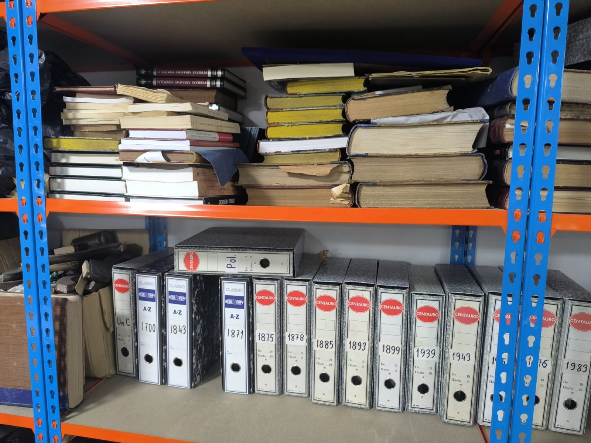

One requirement drives the whole design: **the system must not invent anything.** Plausible but false text is worse than a gap, because it enters the catalogue and nobody looks at it again. Whatever is not read with certainty is returned as `[ilegible]` together with the candidate readings, and it stays that way until two independent readers agree.

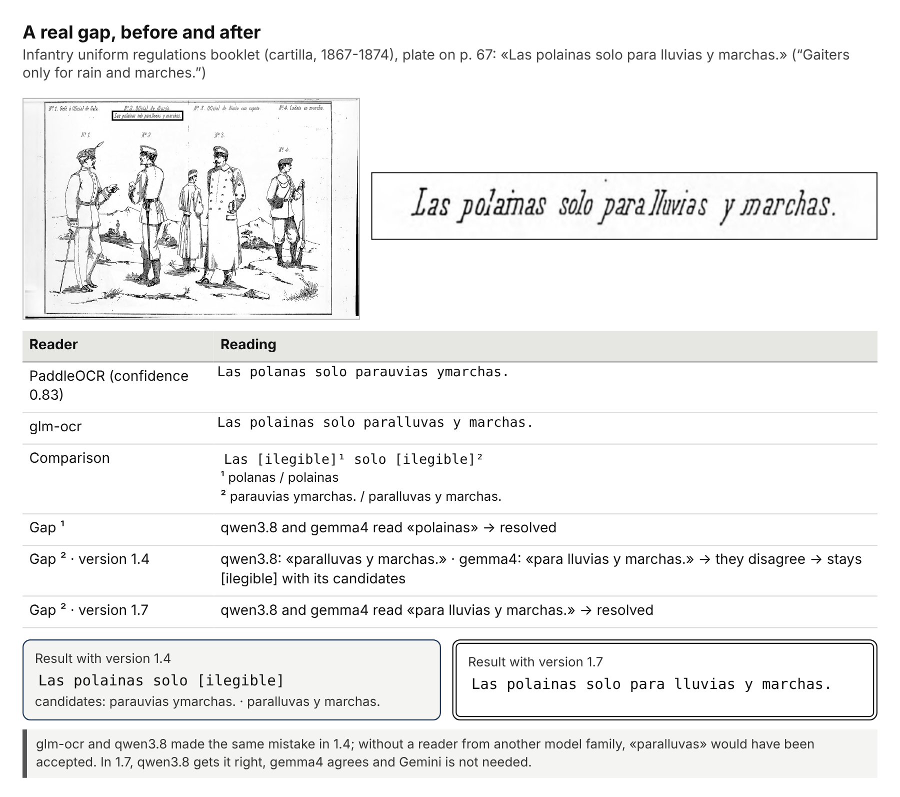

## How it works

Everything runs on my own hardware, with a cloud model only as a last resort.

- **Stage 1, server with an RTX 5090 (32 GB):** PaddleOCR reads lines with boxes and confidence; glm-ocr gives a second reading of tables and doubtful lines; qwen3.8 classifies the document and reads figures and captions. A word-by-word comparison marks every mismatch as `[ilegible]` with its candidates.
- **Stage 2, second machine with an RTX 5070 Ti (16 GB):** gemma4, a model from a different family, re-reads the gaps and votes. It runs in parallel with the next document.
- **Last resort:** Gemini 3.8 Flash sees the whole page and the position of each remaining gap. It also transcribes handwritten documents directly.
- **Tables:** two readings plus arithmetic. Row and column sums are the only evidence that does not depend on any model.
- **Dictionary and human review:** what remains `[ilegible]` goes to a person with the crop and the readings; confirmed words vote from then on.

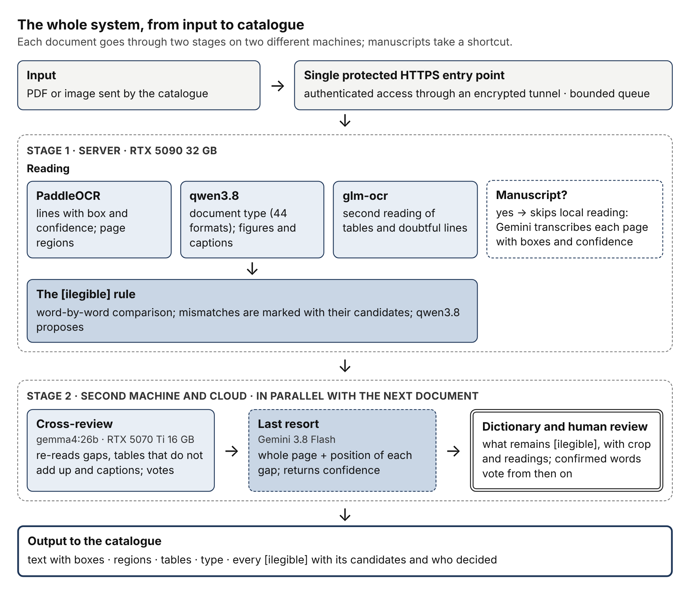

## Results so far

| Measurement | Value |
|---|---|
| One production night (about 8 hours, version 1.4) | 4,093 pages, about 6.8 s per page |
| Lines read that night | 511,017; 96 % with no doubt |
| Table cells corrected by sum checks | 505; 225 of 1,757 tables left flagged for review |
| Batch of eight documents, single stage vs chained stages | 451 s vs 318 s |
| `[ilegible]` marks resolved, local models only vs with Gemini | 46-49 % vs 87-89 % |

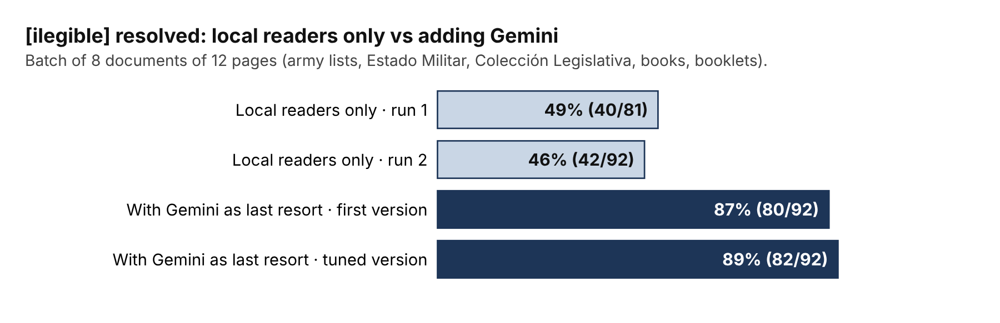

## What worked and what did not

Three lessons so far: marking instead of guessing prevents errors nobody would look at again; a reader from another model family catches errors that two engines share; and table sums are the only objective check. Almost everything that failed had the same root: asking a model to read with nothing to check it against, or paying a fixed cost on documents that did not need it.

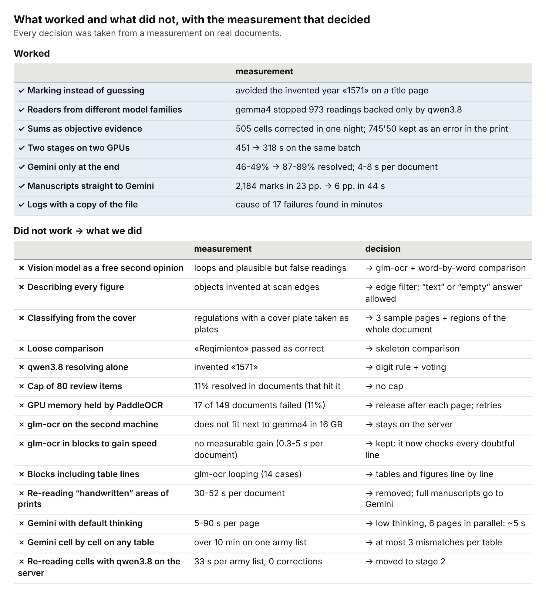

## Progress update: the viewer

The engine now has a reading room. The viewer is a web application built in Node.js that shows what the pipeline has stored and lets a person correct it. It runs no models itself. Every record keeps which engine produced it and in which run, so the viewer can say who did what.

When this section was written it held 267 sources with 7,278 pages, 151,299 text records and 2,599 figures extracted from the books, which is what the screenshot shows; the current figures are in the updates below.

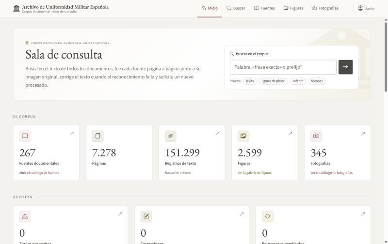

- **Boxes in the right place.** Each engine returns its boxes in its own convention: pixels, coordinates normalised to 0-1000, `x,y` or `y,x`. The viewer converts all of them to a percentage of the page, so a box lands in the same place whatever size the image is shown at. The rule for the main engine was worked out by measuring its boxes against the PDF text layer and against the ink, with an error under 0.5 %. That fixed the displaced boxes and the figure crops that were coming out cut.
- **One colour per region type.** Title, text, table, figure, caption, and headers and page numbers, which are dimmed because they are not content. Image and text are linked: pointing at a paragraph highlights its box, and the other way round.
- **Tables rebuilt.** The engine delivers each table as HTML with merged cells. The viewer cleans it (table tags and text only, never scripts), draws it once with its title next to the original image, and keeps the rows underneath as records that can be copied and corrected one by one.
- **Corrections with history.** Pipeline and viewer share one SQLite database: the pipeline writes, the viewer reads, and the viewer only writes what a person corrects, always keeping the previous value.
- **Versioned analysis of photographs.** Each system that looks at a photograph adds its own version without overwriting the earlier ones, so two systems can be compared side by side on the same image.

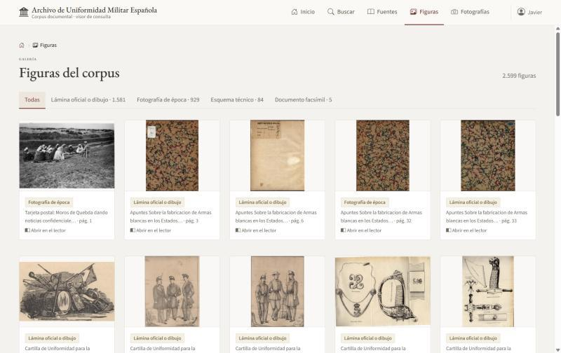

### First test: locating and identifying small objects in photographs

Six portraits, three systems, nothing written to the database.

| System | Where | Boxes | Identification |
|---|---|---|---|
| Grounding DINO (open-vocabulary detector) | Local laptop GPU, about 1 s per pass | Finds the large elements; a lot of noise on small pieces | None |
| Gemini 3.8 Flash | Cloud, about 20 s per photo | Tight and reliable | Gives specific names with moderate confidence |
| DeepSeek Flash | Cloud, about 40 s per photo | Same elements, boxes displaced upwards | Very cautious; leaves most pieces unnamed |

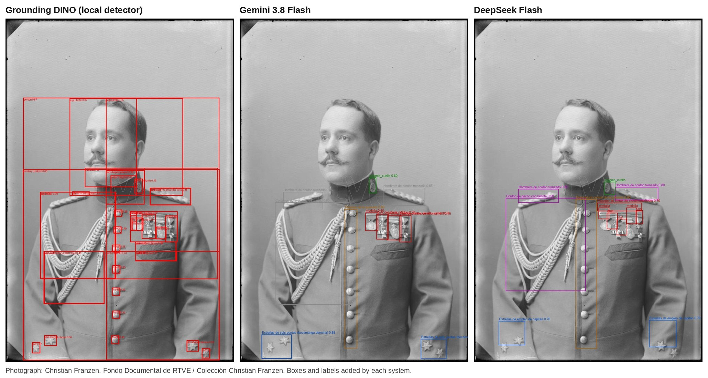

*The same portrait analysed by the three systems. Photograph: Christian Franzen. Fondo Documental de RTVE / Colección Christian Franzen.*

Provisional conclusions: Gemini is clearly the best of the three at locating and identifying, and the local detector is not enough for small pieces. The confidence a model reports is not reliable on its own, so it is stored as given, shown with its source, and a person confirms. No system found every small piece, so those will keep needing human review. Before running this on the full set, accuracy will be measured on a hand-reviewed sample.

### Quality

- Code and data batches reviewed in 16 rounds by a second AI model, always in the same session so it remembers what it has seen. Every finding was checked before fixing it.
- Accessibility to WCAG 2.2 AA: everything works from the keyboard, focus is always visible, text reflows at 320 px.
- Security: strict headers, listens on localhost only, write rate limit, validation of everything written.

## Progress update: the full run

The engine is now working through the whole archive, not a test batch.

| | |
|---|---|
| Scanned books in the corpus | 3,557 |
| Scanned books that need OCR | 1,794 books, 256,825 pages |
| Books with a usable text layer | 58 books, 6,136 pages |
| Loose plates | 1,683 items, 2,033 pages |
| Duplicates found and skipped | 22 books |
| **Books read so far** | **459 (29,079 pages)** |
| **Text records** | **536,558** |
| Pages by type | prose 16,996, tables 9,679, illustrations 2,404 |
| Photographs analysed | 985, with 9,510 elements located and 3,393 identifications proposed |

About 227,000 scanned pages are still to be read, besides the books not scanned yet.

**What worked**

- The orchestrator as the main engine: a median of 11 minutes per book, 56 at most, with high quality.
- Splitting large books (over 100 MB) and dense ones (over 60 pages go in blocks of 40), which removed the timeouts.
- A supervisor that waits for one phase to finish and starts the next.
- A failsafe on the cloud model: on a rate-limit error it waits, on a payment error it stops and warns.

**What did not, and what was changed**

| Problem | Change |
|---|---|
| A one-hour timeout cut off slow books | Raised to 90 minutes |
| A shorter 30-minute timeout failed even more | Reverted: dense books simply need the time |
| A progress watchdog gave false alarms | Removed: the table review stage does not advance the page counter |
| A test sending 10 % of the text to a cloud model produced 14,802 errors | Caused by too many requests at once. Failsafe added and concurrency limited; to be tested again |
| Two books kept blocking the queue | Marked as discarded and skipped |

**New lessons**

1. **The "text" route was misleading.** About 95 % of the PDFs that came with a text layer were scans with a poor OCR layer underneath, not real text. Only 58 are true digital documents; the other 1,326 had to go back to the OCR queue.
2. **Speed depends on density, not only on length.** The cloud model answers a short text in 2.5 seconds, but takes 64 seconds for 15,000 characters and 113 for 37,000.
3. **Most of the data is in the least glamorous books.** Army lists (rosters of personnel) are 72 % of all records.

Still open: whether to process the loose plates at all, and whether to add a third worker.

## Progress update: from text to a database

The text the engine produces now feeds a single database, and several AI systems work on it with separate roles. One person sets the criteria and approves every change.

| | Viewer update | Now |
|---|---|---|
| Sources with pages read | 267 | 776 (of 4,199 catalogue entries, which include books not scanned yet) |
| Pages | 7,278 | 31,789 |
| Text records | 151,299 | 616,420 |
| Text lines with their box | n/a | 3,859,521 |
| Figures extracted | 2,599 | 7,046 |
| Photographs | about 350 | 985 |

### Who proposes does not apply

- The OCR pipeline writes books, pages, records, lines and figures.
- One AI session owns the schema and the catalogue data, and is the only one that changes them.
- A second AI session researches and proposes. It delivers each change as a batch: one SQL file in a transaction plus a note saying what changes and which source supports it.
- Each batch is run twice on a copy (the second run must change nothing), approved by a person, reviewed and applied by the session that owns the database, and then checked read-only on the real database.

No catalogue or uniform batch has had to be reverted. The one rollback was a clean-up that archived 59 records too many, and it could be undone because nothing is ever deleted: what is surplus is marked, not removed.

### Reference catalogues

- **Periods.** 38 periods in three levels, by reign and form of government. The 13 consecutive top-level ones cover 1700 to 1950 with no gaps. Every date carries a state: checked, unchecked, or sources disagree.
- **Conflicts and battles.** 62 conflicts and 83 battles.
- **Organisation.** 76 corps and 60 ranks with their dates of validity, and 121 units taken from a 1909 army yearbook, each with its page as evidence. Units are never written from memory.

A book has two dates: the period it deals with and the year it was published. The 3,326 period assignments keep them apart, and all are stored as proposals until a person confirms them.

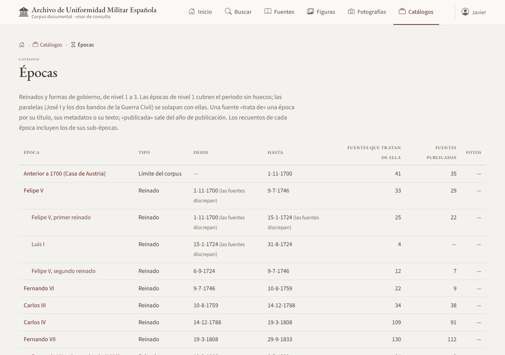

### From the regulation to the uniform

The model separates four things: the regulation, the provision (what the regulation orders about one garment for one subject, with its citation), the subject (for example, a line infantry officer) and the version (the complete uniform for a date range and an order of dress).

Versions are computed, not written by hand. Each provision that comes into force opens a date range, a regulation that replaces another also closes the ones that amended it, conflicts between provisions are flagged and not decided, and versions a person has confirmed are left alone. Every citation is checked against the image of the page, because the text layer of those 19th-century PDFs has too many errors.

So far: 24 regulations, 39 garments, 63 provisions, 4 subjects and 20 computed versions (521 elements) for the infantry of 1861 to 1869, all as proposals.

### Identifying insignia in photographs, measured

On 34 pieces that can be told apart clearly:

| Configuration | Right | Wrong |
|---|---|---|
| Gemini, whole photograph, old prompt | 12 | 5 |
| Gemini, whole photograph, with expert criteria | 9 | 9 |
| Gemini, enlarged crop, with expert criteria | 24 | 1 |
| DeepSeek, enlarged crop, with expert criteria | 11 | 14 |

The method that came out of it has two steps: locate the piece, then identify the crop enlarged to 640 px with the expert's criteria written into the prompt. One caveat: the reference for this test was made by an AI applying the expert's criteria, not by an expert checking piece by piece.

On a sample of 50 photographs the confidence Gemini reports did help to sort: at 0.90 or above, 94 % was right or probable; under 0.70, only 28 %.

### Cleaning the stored data

- **Repeated records.** The pipeline sometimes stored the same page twice, whole and in parts. 17,244 records were exact repeats (3 %), on 614 pages of 182 books. In the worst case, an 1847 army list, 40 % of the records were repeats. Some copies did not even agree with each other, with a date shifted to the next row. The safe ones were archived, 415 pages are queued to be read again and the fault is fixed, although only a few hours of processing confirm it so far.
- **Confused digits** in the gazettes: "1" read as "4" gives impossible years such as 4874.
- **Catalogue entries.** 29 corrections, mostly of year. 44 entries marked as duplicates and 14 as discarded, with nothing deleted.
- **Illegible marks.** 41,949 in the text of the full run. About 10,000 have since been cleaned: marks that were stains rather than text, and corrected text. That kind of mark is what the page cleaning described below is meant to prevent. The API to resolve the rest is built and tested.

Work on uniforms is paused until this clean-up is done, because counts and extractions inherit every duplicate.

### What worked and what did not

Worked:

1. Separating who proposes from who applies, and testing every change on a copy.
2. A second AI as reviewer, with every finding checked before fixing it. In 16 rounds it found real faults, including an endpoint that served any file, the database itself included.
3. Writing the expert's criteria into the prompt as rules.
4. Measuring before deciding: page resolution, OCR engines and identification systems were all chosen with figures.
5. Proposing and confirming without deleting.

Did not work:

1. Trusting what a model says about its own output. Asked to draw an infantry captain of 1861, the model reported that it had met the whole checklist and failed on five points.
2. Correcting a generated image by giving instructions about the image. After a few rounds the model stops fixing and starts making new mistakes. Regenerating from an improved prompt with a drawn schema works better.
3. DeepSeek for small shapes: displaced boxes and round medals taken for crosses. It is useful for reviewing code and data, not for this.
4. Systematic OCR errors that were seen late. Repeated records had been there since the first day.
5. Automatic reading of dates and subjects: two modern order numbers were read as a range of years and filed under the 1820s.
6. Depending on the balance of paid services: a long run stopped when the credit ran out.

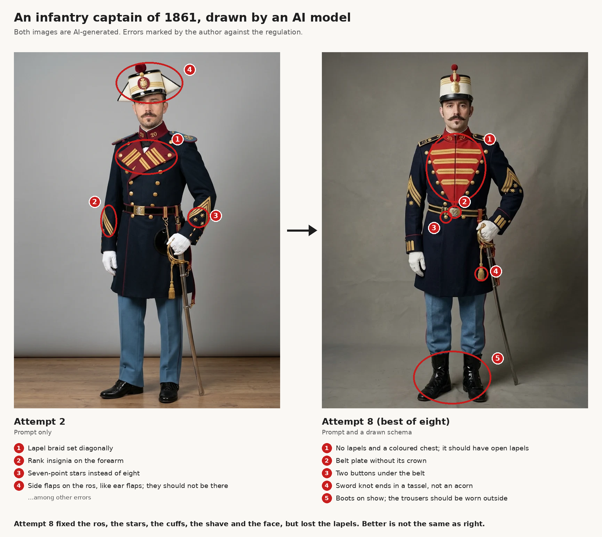

*Both images are AI-generated. Attempt 2 had the prompt only; attempt 8, the best of eight, had the prompt and a drawn schema. Attempt 8 fixed the ros, the stars, the cuffs, the shave and the face, but lost the lapels, and five details are still wrong.*

Three things to take away: no model output is data until someone checks it against the source; traceability is what makes correction possible; and clean before you build on top.

## Progress update: cleaning the page before OCR

Not every page arrives clean. Part of the archive was scanned by others and cannot be scanned again, so the OCR has to work with what there is: the back of the page showing through, ink transferred from the facing page, rust spots and yellowed paper. The OCR read that ghost text as real lines, mirrored or not, put it into the reading order and left `[ilegible]` gaps that then went to paid vision models. In the first review of the reading order, almost every page failed because of ghost sections.

The fix is one step before the OCR, and it uses no AI. That is on purpose: an image "cleaned" by a generative model looks good and invents letters. The rule is the project's usual one: **deleting printed text is worse than leaving a stain.** Nothing is redrawn; only ink that is not printed is removed. The OCR reads the cleaned copy; the original image is kept for figures, review and the viewer.

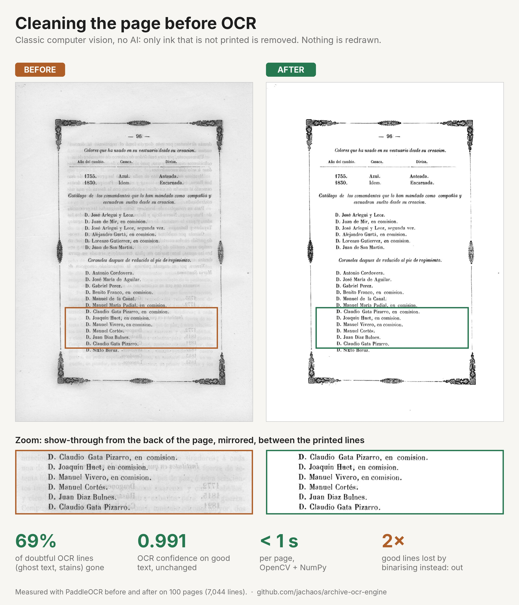

### How it works

Classic computer vision with OpenCV and NumPy, under a second per page. Decisions are made per connected ink component, not per pixel: a printed letter has a dark core even when its edges are pale, so it is not thinned.

1. **Ink map.** The page is divided by its own background (a morphological closing at 1.5 times the letter height), so 0 is paper and 1 is ink.
2. **Tone of the printed text.** The darkest point of each letter-sized component, measured by zones (eight lines by a third of the width).
3. **Cut by tone.** Printed and ghost letters form two groups; Otsu's method finds the cut between them when they are well separated, and a fixed fraction of the tone is used when they are not. The cut never goes above 70 % of the zone's tone.
4. **Ghost from other pages.** Up to two neighbouring pages on each side are aligned over the pale components, flipped and straight. Pale components that fall mostly on the text of a matching neighbour are removed.
5. **Colour** (only on coloured paper or colour pages): what is more colourful than the ink and paler than it, such as brown stains and rust, is removed.
6. **Fill, normalise and levels.** Removed areas are filled with the surrounding paper, the background is normalised to white, and contrast is stretched inside the letters without cutting them.

Safeguards: anything touching a printed letter stays with it; pages with fewer than 40 reference letters are not touched; the search for neighbours is skipped on landscape or double pages. Three profiles (black and white, coloured paper, colour pages) are chosen automatically from the saturation of paper and ink, and every page stores what was done to it (cut, matching neighbours, fraction of ink removed) so it can be reviewed or undone.

### Results

PaddleOCR before and after on 100 pages of the corpus: 7,044 lines, of which 5,618 good (confidence of 0.95 or more) and 822 doubtful (under 0.8).

| Combination | Doubtful lines removed | Good lines "lost" | New good lines | Mean confidence | s/page |
|---|---|---|---|---|---|
| **Otsu tone cut + neighbours + normalise + levels (chosen)** | **565 (69 %)** | 94 | 134 | 0.991 | 0.86 |
| The same without neighbours | 543 | 98 | 133 | 0.991 | 0.13 |
| Fixed cut at 35 % of the tone | 511 | 66 | 123 | 0.991 | 0.86 |
| Chosen profile + binarisation (Sauvola) | 635 | 209 | 145 | 0.987 | 0.89 |
| Normalising only | 203 | 64 | — | — | — |

"Lost" means a good line of the original that does not appear afterwards or changes a lot. Normalising alone, which removes nothing, already gives about 65: that is the noise of the comparison, because the OCR splits lines differently. Three of the chosen profile's cases were checked by hand, and in all three the text is complete in the cleaned image.

### What worked and what did not

Worked: deciding per component instead of per pixel; Otsu's cut instead of a fixed one (on page 96 the ghost peaked at 0.19 and the print at 0.78); filling with the surrounding paper instead of white, which left ghost letters in white; and stretching contrast inside letters without cutting, because a hard cut thinned and broke the strokes.

Did not work: binarising, which breaks thin strokes and loses twice as many good lines; whitening everything outside the text regions, which depends on the layout model getting the regions right and is still being studied. The colour step barely acted on the pages tested, because the stains were already paler than the cut.

Next: plug the step into the pipeline behind a switch and measure, in production, `[ilegible]` gaps per page, calls to paid models and pages sent back for reordering; repeat the reading-order review with clean pages; and check a hand-reviewed sample for pale printed text that should have stayed.

Open question: are library stamps text or stains? With the current rule, pale ones are removed.

## What is not measured yet

This is a preliminary report and it says so where it matters:

- There is no hand-checked reference set yet, so the figures say how much the system doubts and how much it resolves, not how many errors remain unmarked.
- The document classifier is not validated.
- Gemini's confidence is self-reported, not calibrated, and its cost is not measured at scale.

The next step is a hand-reviewed sample of up to 100 pages, one per document, to serve as that reference. A second report will follow.

## Files

- `report/archive_ocr_engine_report_public.pdf` — the report in English
- `report/informe_ocr_archivo_uniformidad_publico.pdf` — the report in Spanish
- `figures/` — the twelve figures of the report, a photo of the archive, three screenshots of the viewer, the detection comparison, two AI-generated images with their errors marked, and a page before and after cleaning

## Author

Javier Chaos — software architect / tech lead (.NET, Azure, Python, computer vision and applied AI).
[LinkedIn](https://www.linkedin.com/in/javierchaos/) · [GitHub](https://github.com/jachaos)

## Licence

Report, text and figures: CC BY 4.0, with one exception. The photograph in `figures/detection_comparison.jpg` is by Christian Franzen and comes from the Fondo Documental de RTVE (Colección Christian Franzen). It is shown here for research purposes, is not covered by the CC BY licence and remains subject to the terms of its source.
